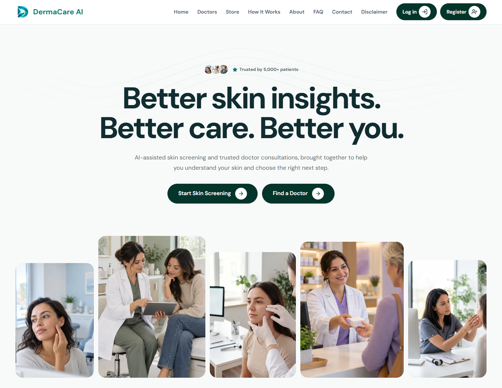

# DermaCare AI: Client

AI-assisted skin screening and teleconsultation platform. This is the **frontend (client)** repository. A patient uploads a skin image, gets a preliminary AI screening, books a verified doctor, joins an online consultation, receives a prescription and orders medicines from the platform's central store.



   

## Links

| | |
|---|---|
| Live site | [https://dermacare-ai-client.onrender.com/](https://dermacare-ai-client.onrender.com/) |
| Backend repository | [https://github.com/DermaCare-Medico/DermaCare-AI-Server](https://github.com/DermaCare-Medico/DermaCare-AI-Server) |

## Important Notice

DermaCare AI is an **educational prototype**.
- The AI gives a preliminary screening only. It is not a medical diagnosis.
- Only a verified doctor can prescribe.
- All medicines, doctors, payments and store data are fictional or sandbox. No real money is charged.

## Features

**Authentication**
- Registration with email OTP, with separate Patient and Doctor tabs.
- Login with email and password, Google login and a demo login.
- Forgot password with OTP.
- Role-based redirect after login.

**Patient**
- Skin screening: image upload, symptom form and AI result page with PDF download (see **Skin Screening** below).
- Prediction history.
- Doctor booking (Pending, doctor approval, then demo payment).
- Appointment cards with video consultation link, prescription view and chat.
- Medicine store, cart, checkout and order history.
- Notifications.

**Doctor**
- Dashboard locked until the Admin approves the account.
- Booking requests with Accept and Cancel.
- Appointment details with the patient's screening, symptoms and history.
- Prescription popup and chat.

**Admin**
- Doctor approval requests, doctors and patients lists.
- Store management and order processing.
- Doctor payments, appointments and audit logs.

## Skin Screening (Main Feature)

Screening is the core of DermaCare AI. It is the first page a patient sees after login. It gives a **preliminary check** and guides the patient to the right next step. It is never a diagnosis.

**Flow:** Upload Image → Image Check → Information Form → Submit → AI Result → Find a Doctor

### Step 1: Image Upload
- Accepts JPG or PNG, up to 10 MB. On mobile, the patient can use the camera or the gallery.
- A preview is shown, and the patient can replace the image before continuing.
- A wrong file type or a file that is too large shows a clear message.
- A blurry or dark image shows a message with tips to retake it.

### Step 2: Information Form
The form appears after the image is added. Some fields are required and some are optional. It uses React Hook Form and Zod, and errors show next to each field.

| Required | Optional |
|---|---|
| Body area | Itching |
| How long the problem has existed | Pain or burning |
| Whether it is spreading or changing | Bleeding or discharge |
| | Fever |
| | Allergies and current medicines |
| | Previous treatment |
| | Extra notes |

### Step 3: AI Result Page
- Shows the top predicted conditions with confidence scores.
- Always shows the disclaimer: "This is a preliminary screening, not a medical diagnosis."
- Shows condition information and natural care only when the backend allows it.
- Buttons: **Download PDF**, **Find a Doctor** and **New Screening**.

The backend applies the risk rules. The client shows what the backend returns:

| Situation | What the patient sees |
|---|---|
| Confidence below 60% | "The result is uncertain. Please consult a doctor." Natural care is hidden. |
| High-risk condition above 20% | A strong "See a doctor soon" message. Natural care is hidden. |
| Red-flag symptoms | An urgent warning that overrides everything else: "These symptoms may need urgent medical attention. Please visit a doctor or emergency service immediately." |
| Normal result | Condition information, and natural care only if the condition is marked safe for home care. |

### Saved Results
- Every result is saved automatically.
- It appears in **Dashboard → Prediction History** with the date, top result and confidence.
- The patient can open it again and download the PDF at any time. The PDF includes the date, predicted conditions, confidence scores and the disclaimer.

### Loading and Error States
- While the image is analyzed (normally within about 10 seconds), a loading message is shown.
- If the AI is unavailable, a message appears and the patient can still continue to book a doctor.
- If the upload fails, the patient can retry without losing the form data.
- If the session expires, the patient is sent to the login page.

### Safety Rules in the Interface
- The AI result never shows medicines or dosages.
- Natural care is shown only when the backend provides it.
- Images are private and are shown only through signed links.

### Supported Conditions
The conditions come from the AI model used by the backend. The primary model, VeritaDerm, covers acne, keratosis pilaris, eczema, leprosy, psoriasis, ringworm, warts and healthy skin. This list may change if the model changes.

## Tech Stack

| Area | Technology |
|---|---|
| Framework | Next.js 16 (App Router), React 19, TypeScript |
| Styling | Tailwind CSS 4, shadcn/ui style components on Radix UI, tailwind-merge, class-variance-authority |
| State | Redux Toolkit, React Redux, redux-persist |
| Authentication | NextAuth, jose, jwt-decode, js-cookie |
| Forms | React Hook Form, Zod, input-otp, react-phone-input-2 |
| Data display | TanStack Table, react-day-picker, date-fns, Embla Carousel |
| Animation and visuals | Framer Motion, Lottie, Three.js, react-fast-marquee |
| Feedback and icons | Sonner (toasts), Lucide icons |

## Getting Started

**Requirements:** Node.js 20 or later, and npm.

```bash
# 1. Clone the repository
git clone https://github.com/your-org/your-client-repo.git
cd your-client-repo

# 2. Install dependencies
npm install

# 3. Create the environment file
cp .env.example .env.local

# 4. Start the development server
npm run dev
```

Open [http://localhost:3000](http://localhost:3000).

## Environment Variables

Create `.env.local` in the project root. The names below are examples. Match them to your project's `.env.example`.

```env
NEXT_PUBLIC_API_URL=http://localhost:5000/api/v1
NEXTAUTH_URL=http://localhost:3000
NEXTAUTH_SECRET=your-secret
GOOGLE_CLIENT_ID=your-google-client-id
GOOGLE_CLIENT_SECRET=your-google-client-secret
```

Never commit `.env` files or secrets.

## Scripts

| Command | What it does |
|---|---|
| `npm run dev` | Start the development server |
| `npm run build` | Create a production build |
| `npm run start` | Run the production build |
| `npm run lint` | Check the code with ESLint |
| `npx tsc --noEmit` | Check TypeScript types |

## Before You Push

- Run `npm run build`, `npm run lint` and `npx tsc --noEmit`. If any of them fails, do not push.
- Do not use `@ts-ignore` to hide errors, and remove `console.log` and unused code.
- Never push directly to `main`. Work on your own branch and open a pull request with at least one review.
- Follow the API contract (Swagger). Tell the team before an endpoint changes.

## Deployment

The client is deployed on Vercel. Add the environment variables in the Vercel project settings, and add the live domain to the allowed redirect URLs of the Google OAuth app.

## Team North-Star

| Member | Role | GitHub |
|---|---|---|
| Nishat Jahan | Team Leader | [@nishatjahan62](https://github.com/nishatjahan62) |
| Yeasin Miazi | Co-Leader | [@miazi2003](https://github.com/miazi2003) |
| Arafat Hossen Joni | Frontend Developer 1 | [@arafat717](https://github.com/arafat717) |
| Md. Kamruzzam | Frontend Developer 2 | [@anamolhasan](https://github.com/anamolhasan) |
| Anamol Hossen | Frontend Developer 3 | [@kamrul125](https://github.com/kamrul125) |
## License

Educational project. All rights reserved by the team unless a license is added.